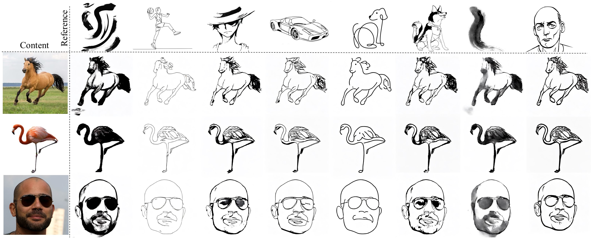

# Stroke2Sketch: Harnessing Stroke Attributes for Training-Free Sketch Generation - ICCV 2025

[[Paper]](http://arxiv.org/abs/2510.16319) | [[Paper (ICCV)]](https://openaccess.thecvf.com/content/ICCV2025/papers/Yang_Stroke2Sketch_Harnessing_Stroke_Attributes_for_Training-Free_Sketch_Generation_ICCV_2025_paper.pdf) | [[Project Page]](https://rane7.github.io/Stroke2Sketch/)

We propose Stroke2Sketch, a framework that accurately transfers stroke attributes from a reference sketch to a content image while preserving structure and style fidelity. The top row shows reference sketches, the leftmost column displays content images, and the central and right columns illustrate our method’s precise content preservation and expressive stroke transfer.



## 一键部署

将整个 `Stroke2Sketch` 目录复制到一台 Linux x86_64、带 NVIDIA CUDA GPU 的服务器后，在项目目录执行。服务器需已安装 NVIDIA 驱动（`nvidia-smi` 能正常运行）；首次安装需要联网：

```bash
cd /path/to/Stroke2Sketch
bash setup.sh --background
```

当前服务器上的项目也可以直接使用绝对路径启动：

```bash
bash /home/duanzhenwei/color/deeplearning/Stroke2Sketch/setup.sh --background
```

`setup.sh` 会自动完成以下工作：检测或安装 Miniconda、创建独立的 Python 3.8 环境 `stroke2sketch-runtime`、安装 CUDA 版 PyTorch 和项目依赖、下载 Stable Diffusion 1.5 所需的模型文件、检查 CUDA 运算和网页模块，再启动 Gradio 网页。已安装的依赖和已有的 `.safetensors` / `.bin` 权重会复用，缺失文件自动补齐；脚本按自身位置定位项目，也可以从其他目录调用。日志在 `output/app.log`，启动后访问 `http://<服务器IP>:7860`，停止服务使用脚本打印的 PID。

只安装环境和模型而不启动网页：

```bash
bash setup.sh --no-start
```

默认使用清华 PyPI 镜像下载依赖、`https://hf-mirror.com` 下载模型。网络可直连官方源时，可用标准环境变量切换：

```bash
PIP_INDEX_URL=https://pypi.org/simple HF_ENDPOINT=https://huggingface.co bash setup.sh --background
```

网页默认关闭 `Apply Mask`，因此不需要 U2Net 权重即可生成素描。若要启用遮罩，将下文模型下载地址提供的 `u2net.pth` 放入 `U2Net_/saved_models/`；也可将 `U2NET_URL` 设为权重文件的直接下载地址：

```bash
U2NET_URL='实际的权重文件直链' bash setup.sh --with-u2net --no-start
```

如果服务器没有可用的 Conda，脚本会将 Miniconda 安装到 `$HOME/miniconda3`，可用 `CONDA_ROOT=/path/to/miniconda3` 指定安装位置。若需使用已有环境，可设置 `STROKE2SKETCH_ENV=环境名`。脚本支持 `--port 端口` 指定网页端口；该端口需空闲，启动错误可查看日志。前台启动使用 `bash setup.sh`，按 `Ctrl+C` 停止。

安装后若要在同一运行环境中执行命令行推理，先激活 `stroke2sketch-runtime`，再执行下文的 `python run.py ...` 示例。

## 服务器使用说明

当前服务器配置如下。服务器地址为内网地址，客户端需要能够连接服务器所在网络。

| 项目 | 当前配置 |
| --- | --- |
| 服务器 IP | `10.19.20.6` |
| 登录用户 | `duanzhenwei` |
| 项目目录 | `/home/duanzhenwei/color/deeplearning/Stroke2Sketch` |
| Conda 目录 | `/home/duanzhenwei/miniconda3` |
| Conda 环境 | `stroke2sketch` |
| 网页默认端口 | `7860` |

### 登录并激活环境

在自己的电脑终端登录服务器：

```bash
ssh duanzhenwei@10.19.20.6
```

登录后执行以下命令。当前服务器已有环境和模型，日常使用可直接激活环境，然后按下文启动网页或运行命令行推理：

```bash
cd /home/duanzhenwei/color/deeplearning/Stroke2Sketch
source /home/duanzhenwei/miniconda3/etc/profile.d/conda.sh
conda activate stroke2sketch
```

下文除 SSH 和浏览器访问外，命令均在服务器的项目目录执行。其他服务器请将 IP、用户名和安装路径改为实际配置。

## 环境依赖下载与代码编译

本项目是 Python 程序，无需 CMake、Make 或手动编译 CUDA 扩展。推理需要支持 CUDA 的 NVIDIA GPU 和可用的 NVIDIA 驱动。以下安装步骤用于首次部署；当前服务器日常使用无需重复安装。

### 下载并安装 Miniconda（未安装时）

以下命令适用于 Linux x86_64 服务器，只在 `/home/duanzhenwei/miniconda3` 尚未安装时执行：

```bash
wget https://repo.anaconda.com/miniconda/Miniconda3-latest-Linux-x86_64.sh -O /tmp/Miniconda3.sh
bash /tmp/Miniconda3.sh -b -p /home/duanzhenwei/miniconda3
source /home/duanzhenwei/miniconda3/etc/profile.d/conda.sh
```

### 创建环境并下载依赖

创建 Python 3.8 环境：

```bash
conda create -n stroke2sketch python=3.8 pip -y
conda activate stroke2sketch
python -m pip install --upgrade "pip<25.1"
```

从 PyTorch 官方源下载 CUDA 11.8 版 PyTorch 和 torchvision：

```bash
python -m pip install torch==2.0.1 torchvision==0.15.2 \
  --index-url https://download.pytorch.org/whl/cu118
```

下载并安装网页、扩散模型和图像处理依赖：

```bash
python -m pip install \
  numpy==1.24.1 Pillow==10.1.0 opencv-python-headless==4.8.1.78 \
  diffusers==0.19.3 transformers==4.30.2 huggingface-hub==0.19.4 \
  accelerate==0.20.3 safetensors==0.5.3 \
  gradio==4.44.1 fastapi==0.116.1 pydantic==2.10.6 \
  pyrallis==0.3.1 kornia==0.7.3 kornia-rs==0.1.10 \
  scikit-image==0.21.0 scikit-learn==1.3.0 scipy==1.10.1 \
  nltk==3.8.1 tqdm==4.64.1
```

PyTorch 安装命令见 [官方历史版本说明](https://pytorch.org/get-started/previous-versions/#v201)；服务器使用 [OpenCV headless](https://pypi.org/project/opencv-python-headless/4.8.1.78/) 提供 `cv2`，无需桌面 GUI。上述安装命令采用与项目对应的核心依赖版本；`requirements.txt` 中的 `huggingface-hub==0.17.3` 与 Gradio 4.44.1 的要求冲突，因此这里使用 `0.19.4`。

也可使用完整环境导出文件创建环境，替代上述手动创建和安装步骤（两种方式选其一）：

```bash
conda env create -f environment.yaml
conda activate stroke2sketch
```

### 检查 GPU 和依赖

```bash
nvidia-smi
python -c "import torch; print('PyTorch:', torch.__version__); print('CUDA available:', torch.cuda.is_available())"
python run.py --help
```

`nvidia-smi` 应能显示显卡，`CUDA available` 应为 `True`；`run.py --help` 应输出参数列表。如果 CUDA 为 `False`，先解决驱动或 PyTorch CUDA 环境问题，再启动推理。

### 模型准备

Stable Diffusion 从 [stable-diffusion-v1-5](https://huggingface.co/stable-diffusion-v1-5/stable-diffusion-v1-5) 下载，放在 `model/stable-diffusion-v1-5/`。代码读取完整的 Diffusers 模型目录，需要包含以下配置和各子目录中的权重，单独的 `.ckpt` 文件不能直接使用：

```text
model/stable-diffusion-v1-5/
├── model_index.json
├── feature_extractor/
├── scheduler/
├── text_encoder/
├── tokenizer/
├── unet/
└── vae/
```

默认的 `canny` + 关闭 `Apply Mask` 只需 Stable Diffusion 模型。启用其他选项时还需要：

- `Edge Method = teed`：`TEED/checkpoints/BIPED/7/7_model.pth`，仓库已附带。
- 勾选 `Apply Mask`：`U2Net_/saved_models/u2net.pth`，可从 [Google Drive](https://drive.google.com/file/d/1IG3HdpcRiDoWNookbncQjeaPN28t90yW/view) 或 [百度网盘](https://pan.baidu.com/share/init?surl=BYT5Ts6BxwpB8_l2sAyCkw) 下载（提取码：`chgd`）。

### 编译检查

激活环境后，可将源码编译为 Python 字节码，检查语法是否正确：

```bash
python -m py_compile app.py run.py models/*.py utils/*.py TEED/*.py U2Net_/*.py
```

命令成功时没有输出，字节码生成在各目录的 `__pycache__/` 中。此步骤只检查语法；实际启动会加载依赖，点击生成时才执行模型推理。

## 交互网页

### 在服务器前台启动

在已激活的 `stroke2sketch` 环境中执行：

```bash
python app.py
```

前台启动时需保持 SSH 终端运行，按 `Ctrl+C` 停止服务。

### 后台启动、查看日志和停止

需要断开 SSH 后继续运行时，使用后台启动方式：

```bash
mkdir -p output
nohup python -u app.py > output/app.log 2>&1 &
echo "服务 PID：$!"
```

记录打印的服务 PID。查看启动地址、推理进度或错误信息：

```bash
tail -f output/app.log
```

退出日志查看按 `Ctrl+C`，网页服务仍会运行。停止后台服务时，将下面的 `SERVER_PID` 替换为启动时记录的数字：

```bash
kill SERVER_PID
```

停止服务后可重新执行后台启动命令。查看 GPU 显存和进程占用可运行 `nvidia-smi`。

### 从自己的电脑访问网页

服务监听 `0.0.0.0`。启动后，在能连通服务器且允许访问 7860 端口的电脑浏览器中打开 [服务器交互网页 http://10.19.20.6:7860](http://10.19.20.6:7860)。自己电脑的 `localhost` 指向自己电脑，直接访问服务器请使用服务器 IP。

如果只能通过 SSH 连接服务器，可在自己电脑另开终端建立端口转发：

```bash
ssh -N -L 7860:127.0.0.1:7860 duanzhenwei@10.19.20.6
```

保持该终端运行，再在自己电脑浏览器打开 [http://localhost:7860](http://localhost:7860)。关闭转发终端会断开网页访问，服务器后台服务继续运行。

如果服务器的 7860 已被占用，Gradio 会尝试其他端口，以启动终端或 `output/app.log` 打印的实际端口为准；直接访问 URL 和 SSH 转发中的远端端口也要相应修改。当前 `share=False`，不会生成 Gradio 公网分享链接。

### 使用步骤与默认参数

1. 在 **Content Input** 上传内容照片，在 **Reference Sketch Input** 上传参考素描；也可点击右侧 **Example Candidates** 填入示例图片。
2. 设置参数后点击 **Run**。首次生成需要加载模型并进行 DDPM inversion，耗时会比后续使用缓存的生成更长。
3. 在右侧 **Sketch Output** 查看生成的 512 × 512 素描，结果也会保存到项目的 `output/` 目录。

网页默认使用细线与发型保持设置，说明见 [report.md](report.md)：

| 网页参数 | 默认值 | 说明 |
| --- | --- | --- |
| Skip Steps | `30` | 反向生成时跳过的扩散步数 |
| Gamma | `0.10` | 轮廓 query 的混合比例 |
| Edge Method | `canny` | 可选 `canny` 或 `teed` |
| Edge Alpha | `0.55` | 当前代码不使用此值调整提边结果 |
| Swap Guidance Scale | `2.5` | 跨图像引导强度 |
| Contrast Strength | `1.0` | attention 对比度调整系数 |
| Load Latents | 勾选 | 优先读取已有 latent 缓存，无缓存时自动计算并保存 |
| Apply Mask | 不勾选 | 勾选后使用 U2Net 主体遮罩 |

生成素描保存为 `output/out_ske-skip_steps_30_gamma_0.1-SGS_2.5-CS_1.0.png`（文件名随参数变化），同时保存参考、内容、轮廓和拼接图。Latent 缓存在 `output/latents/`；取消勾选 `Load Latents` 可重新计算。同一组参数再次生成会覆盖同名结果，需要保留时请先另存图片。

## 命令行运行

也可直接使用仓库示例图片推理，结果保存到 `output/cli/`：

```bash
python run.py \
  --cnt_path data/cnt/cnt1.jpg \
  --ref_path data/ref/ref1.jpg \
  --output_path output/cli \
  --edge_method canny \
  --apply_mask false \
  --skip_steps 30 \
  --gamma 0.10 \
  --swap_guidance_scale 2.5 \
  --contrast_strength 1.0 \
  --load_latents true \
  --device cuda
```

运行 `python run.py --help` 查看全部参数。命令行参数由环境中的 `pyrallis` 解析。

## Acknowledgements

Stroke2Sketch is highly built on [Cross-Image-Attention](https://github.com/garibida/Cross-Image-Attention), [diffusers](https://github.com/huggingface/diffusers) library, and [Edit-Friendly DDPM Inversion](https://github.com/inbarhub/DDPM_inversion).

## Citation

If you use the code and models please cite:

```
@inproceedings{yang2025stroke2sketch,
  title={Stroke2Sketch: Harnessing Stroke Attributes for Training-Free Sketch Generation},
  author={Yang, Rui and Li, Huining and Long, Yiyi and Wu, Xiaojun and He, Shengfeng},
  booktitle={Proceedings of the IEEE/CVF International Conference on Computer Vision},
  pages={16545--16554},
  year={2025}
}
```
